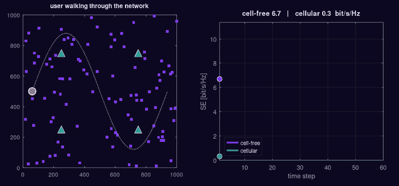
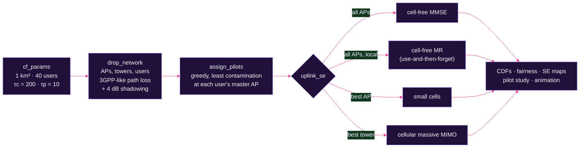
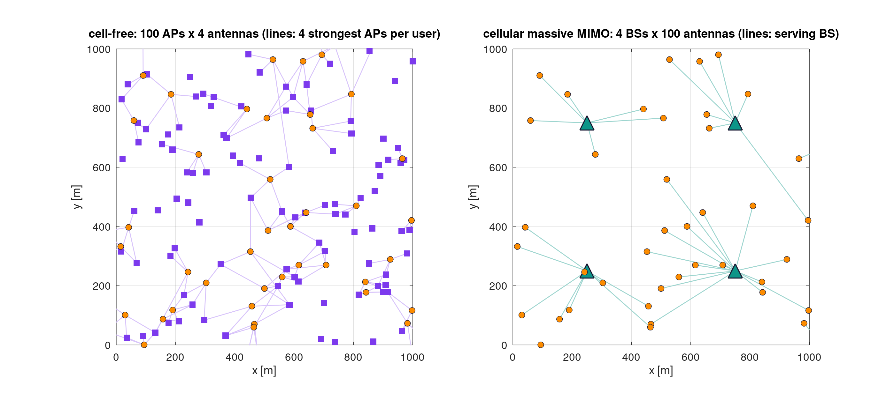
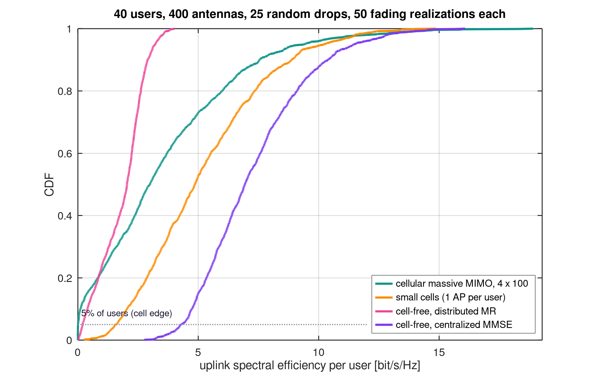
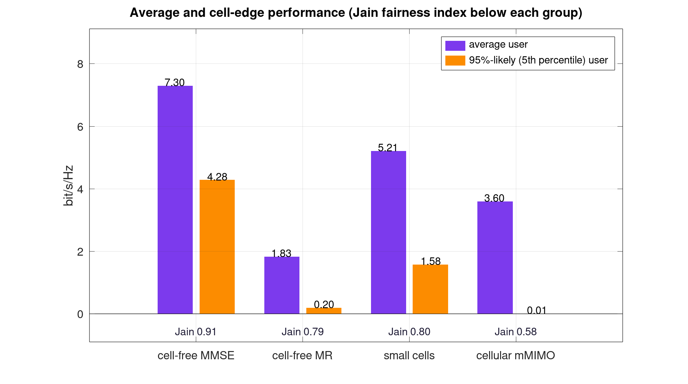
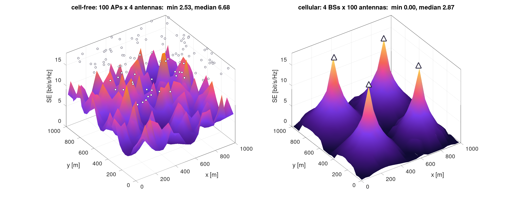
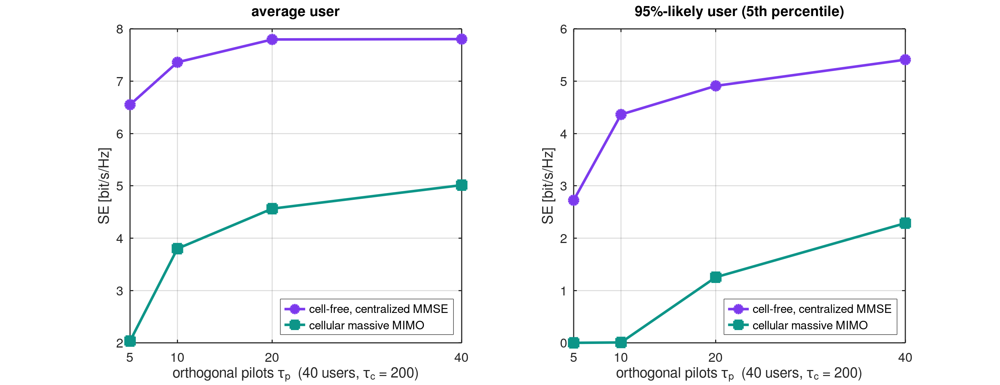

<p align="center"></p>

<p align="center">


</p>

<h3 align="center">Same 400 antennas, same 40 users. Spread them out instead of stacking them on four towers,<br>and the worst user goes from almost nothing to 4.28 bit/s/Hz.</h3>

A cellular network splits the city into cells. Each user talks to one tower, and a user at the border between two cells is far from both and hears both: weak signal, strong interference. That user is why your phone shows full bars in one street and drops calls in the next.

**Cell-free massive MIMO** removes the cells. Many small access points (APs) are spread over the area and connected to a central processor. Every AP listens to every user, and the processor combines all of their signals. There is no edge, because there are no cells to have an edge.

This repository puts the two ideas side by side in plain MATLAB, with **the same number of antennas and the same users**:

| | Cell-free | Cellular massive MIMO |
|:--|:--|:--|
| Infrastructure | 100 APs × 4 antennas, random positions | 4 base stations × 100 antennas, a 2 × 2 grid |
| Who serves a user | all 100 APs together | the one base station with the strongest signal |
| Processing | centralized MMSE (or local MR, the original proposal) | MMSE at the base station |
| Plus | small cells: each user served by its single best AP | |

<table>
<tr>
<td align="center" width="25%"><h2>4.28</h2><sub>bit/s/Hz for the 95%-likely user<br>with cell-free MMSE<br>(cellular: <b>0.006</b>)</sub></td>
<td align="center" width="25%"><h2>7.30</h2><sub>bit/s/Hz average user,<br>cell-free MMSE<br>(cellular: 3.60)</sub></td>
<td align="center" width="25%"><h2>0.91</h2><sub>Jain fairness index<br>(cellular: 0.58,<br>1.0 = everyone equal)</sub></td>
<td align="center" width="25%"><h2>2.53</h2><sub>bit/s/Hz at the <b>worst</b> spot<br>on the map, cell-free<br>(cellular: 0.00)</sub></td>
</tr>
</table>

<p align="center"></p>
<p align="center"><sub>One user walks across the network (left). Right: its spectral efficiency, cell-free in violet, cellular in teal. Each time it walks between two towers, the cellular curve falls to zero. The cell-free curve has dips too, but never falls off a cliff.</sub></p>

---

## ◈ Run it

```matlab
>> main                          % MATLAB R2016b or newer, no toolboxes
```
```bash
octave --no-gui --eval main      # GNU Octave 6 or newer
```

One run takes about five minutes on a laptop core. It writes five figures to [`figures/`](figures), the raw numbers to [`results/`](results) as CSV, and a plain-text [`results/summary.txt`](results/summary.txt). Every figure and number on this page was produced by running this exact code in **GNU Octave 10.3**. The build machine has no MATLAB licence, so the code uses only base functions that behave the same in both.



## ◈ The model

**Area.** A 1 km × 1 km square with wrap-around: a user near the right border sees the APs near the left border as neighbours. This removes artificial edge effects, so every user lives in the same kind of neighbourhood.

**Path loss** (3GPP urban microcell, 2 GHz, in dB, distance $d$ in metres, 10 m height difference):

$$\beta_{kl}\,[\text{dB}] = -30.5 - 36.7\log_{10}\!\Big(\sqrt{d_{kl}^2 + 10^2}\Big) + F_{kl}, \qquad F_{kl}\sim\mathcal{N}(0,\,4^2)$$

**Channels.** Uncorrelated Rayleigh fading, $\mathbf{h}_{kl}\sim\mathcal{CN}(\mathbf{0},\beta_{kl}\mathbf{I}_N)$, constant over a coherence block of $\tau_c = 200$ samples. Every user sends 100 mW over 20 MHz with a 7 dB noise figure (noise floor −94 dBm).

**Pilots.** Only $\tau_p = 10$ orthogonal pilots exist for 40 users, so each pilot is shared by 4 users. The first 10 users take one pilot each. Each later user picks the pilot that is least used around its strongest AP (the greedy method of Björnson and Sanguinetti, 2020). Each AP estimates every channel with MMSE:

$$\hat{\mathbf{h}}_{kl} = \frac{\sqrt{p\tau_p}\,\beta_{kl}}{p\tau_p\sum_{i\in\mathcal{P}_k}\beta_{il} + \sigma^2}\;\mathbf{y}^{\text{pilot}}_{l,t_k}$$

where $\mathcal{P}_k$ is the set of users sharing user $k$'s pilot. Those users are *pilot contamination*: their channels leak into the estimate.

**Combining and spectral efficiency.** With centralized MMSE the processor stacks the antennas that serve user $k$ and computes

$$\mathbf{v}_k = p\Big(\sum_{i=1}^{K} p\,\hat{\mathbf{h}}_i\hat{\mathbf{h}}_i^{H} + \mathbf{Z} + \sigma^2\mathbf{I}\Big)^{-1}\hat{\mathbf{h}}_k,\qquad
\text{SE}_k = \Big(1-\frac{\tau_p}{\tau_c}\Big)\,\mathbb{E}\big\{\log_2(1+\text{SINR}_k)\big\}$$

where $\mathbf{Z}$ holds the estimation-error covariances. The expectation is taken by Monte Carlo over the fading. The same routine gives small cells and cellular massive MIMO: only the set of antennas that serve each user changes. Local MR at every AP, summed at the processor, is evaluated with the standard use-and-then-forget bound.

## ◈ Results

### 1. The two networks

<p align="center"></p>

Same users, same 400 antennas. On the left each user is drawn with its four strongest APs (in reality all 100 serve it). On the right each user has one tower. Lines that leave the square come back on the other side: the area wraps around.

### 2. Everyone's spectral efficiency

<p align="center"></p>

1,000 user positions (25 random drops × 40 users), 50 fading realizations each. Read the curves from the bottom: the left end of each curve is the unluckiest users. The violet curve (cell-free MMSE) does not start until 2.8 bit/s/Hz. The teal curve (cellular) starts at zero and stays near zero for about 15% of users: those are the users between towers.

### 3. Average user, edge user, fairness

<p align="center"></p>

| Architecture | Mean SE | 95%-likely SE (5th percentile) | Jain fairness |
|:--|--:|--:|--:|
| **Cell-free, centralized MMSE** | **7.30** | **4.28** | **0.91** |
| Small cells (best AP, MMSE) | 5.21 | 1.58 | 0.80 |
| Cellular massive MIMO (best tower, MMSE) | 3.60 | 0.006 | 0.58 |
| Cell-free, distributed MR | 1.83 | 0.20 | 0.79 |

*Spectral efficiency in bit/s/Hz per user. Jain's index is* $(\sum x)^2 / (K\sum x^2)$.

Three things stand out:

* **Cell-free MMSE wins on both axes.** It doubles the average user of the cellular network, and its 5th-percentile user is better off than the *average* user of a small-cell network.
* **Distributing the antennas is not enough by itself.** With simple maximum-ratio combining at each AP, cell-free is the worst of the four. MR cannot cancel interference, and in a dense network with shared pilots interference is everything. This is the central finding of Björnson and Sanguinetti (2020): cell-free massive MIMO only becomes competitive with MMSE processing. This repository reproduces it.
* **Small cells are a strong baseline.** Using only the best AP already beats cellular on average. Cell-free adds about 2 bit/s/Hz for the average user and multiplies the edge user by 2.7.

### 4. A map of the service

<p align="center"></p>

One test user is moved over a 26 × 26 grid while the other 39 users stay put. The height of the surface is that user's spectral efficiency. The cellular network is four mountains with valleys at zero between them. The cell-free network is rough, but there is no valley: the minimum over the whole map is 2.53 bit/s/Hz, against 0.00 for cellular, and the median is 6.68 against 2.87.

### 5. How many pilots?

<p align="center"></p>

Every pilot sample is a sample not used for data (pre-log factor $1-\tau_p/\tau_c$). Fewer pilots means more data time but more users per pilot and more contamination.

| $\tau_p$ | Users per pilot | Cell-free mean | Cell-free 5% | Cellular mean | Cellular 5% |
|--:|--:|--:|--:|--:|--:|
| 5 | 8 | 6.55 | 2.73 | 2.03 | 0.0003 |
| 10 | 4 | 7.36 | 4.36 | 3.80 | 0.007 |
| 20 | 2 | 7.80 | 4.91 | 4.56 | 1.25 |
| 40 | 1 | 7.81 | 5.41 | 5.01 | 2.29 |

Cell-free tolerates pilot reuse much better. With 8 users on each pilot it still gives its 5th-percentile user 2.73 bit/s/Hz. The cellular network needs a pilot per user before its edge users recover, and even then they get less than cell-free at $\tau_p = 5$. The reason: a cell-free user is usually close to *some* AP that its co-pilot users are far from, so the processor can tell them apart.

## ◈ What this simulation leaves out

* **Uplink only.** The downlink follows by uplink-downlink duality with similar trends, but it is not simulated here.
* **Uncorrelated fading.** Real arrays see spatially correlated channels, which helps MMSE more than MR.
* **Fronthaul.** All APs send their signals to one processor over links assumed to be perfect. In a real deployment that fronthaul is the main cost, and "user-centric" cell-free networks serve each user with only its nearby APs to keep it manageable. The `serve` matrix in [`uplink_se.m`](src/uplink_se.m) takes any AP-user serving set, so that variant is a one-line change.
* **Equal power.** Every user transmits 100 mW. Power control would raise the edge users of every architecture.
* **Monte Carlo noise.** 25 drops with 50 fading realizations each (30 for the pilot study). The seeds are fixed, so `main` reproduces these numbers exactly; other seeds move them slightly.

## ◈ Repository map

```
cell-free-massive-mimo-matlab/
├── main.m                 runs everything, writes results/summary.txt
├── src/
│   ├── cf_params.m        every parameter in one place
│   ├── drop_network.m     random APs, 2 × 2 towers, users, large-scale gains
│   ├── pathloss_db.m      3GPP urban micro + shadowing
│   ├── wrap_distance.m    distances on the wrap-around square
│   ├── assign_pilots.m    greedy pilot assignment
│   ├── uplink_se.m        MMSE estimation, MMSE / MR combining, SE by Monte Carlo
│   └── palette.m, save_figure.m, write_csv.m
├── experiments/
│   ├── run_schemes.m      the four architectures for one drop
│   ├── exp1_cdf.m         CDF, mean, 5th percentile, Jain index
│   ├── plot_layout.m      the two networks
│   ├── exp2_se_map.m      SE landscape of a test user
│   ├── exp3_pilots.m      pilot-length study
│   └── make_frames.m      frames of the walking-user animation
├── figures/  results/  assets/
```

## ◈ References

1. E. Björnson and L. Sanguinetti, "Making cell-free massive MIMO competitive with MMSE processing and centralized implementation," *IEEE Trans. Wireless Commun.*, vol. 19, no. 1, pp. 77–90, 2020.
2. H. Q. Ngo, A. Ashikhmin, H. Yang, E. G. Larsson and T. L. Marzetta, "Cell-free massive MIMO versus small cells," *IEEE Trans. Wireless Commun.*, vol. 16, no. 3, pp. 1834–1850, 2017.
3. Ö. T. Demir, E. Björnson and L. Sanguinetti, *Foundations of User-Centric Cell-Free Massive MIMO*, Foundations and Trends in Signal Processing, 2021.
4. E. Björnson, J. Hoydis and L. Sanguinetti, *Massive MIMO Networks: Spectral, Energy, and Hardware Efficiency*, Foundations and Trends in Signal Processing, 2017.
5. 3GPP TR 38.901, *Study on channel model for frequencies from 0.5 to 100 GHz*.

## ◈ Cite

```bibtex
@software{salim_cellfree_2026,
  author = {Salim, Jaafar},
  title  = {Cell-Free versus Cellular Massive MIMO: a MATLAB Study},
  year   = {2026},
  url    = {https://github.com/jafarSalim/cell-free-massive-mimo-matlab}
}
```

<p align="center"><sub>MIT licence · Eng. Jaafar Salim · built with MATLAB-compatible code, figures rendered in GNU Octave 10.3</sub></p>
